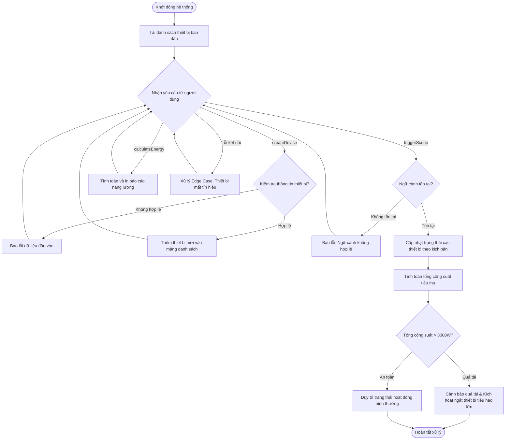

# BÁO CÁO BÀI TẬP: THIẾT KẾ PHÂN HỆ ĐIỀU PHỐI NGỮ CẢNH TỰ ĐỘNG HÓA KHÔNG GIAN SỐNG THÔNG MINH

> 👤 **Học viên:** Hoàng Công Dũng | **Mã SV:** PTIT-HCM-009
> 🏫 **Môn học:** it103b-rl-HoangCongDung

---

## 📊 Sơ đồ thiết kế hệ thống (Flowchart)

> 💡 *Sơ đồ dưới đây được render tự động trực tiếp trên GitHub bằng Mermaid. Bạn cũng có thể tải file **`bt4.drawio`** trong repository này để mở và chỉnh sửa trực tiếp trên [Draw.io (diagrams.net)](https://app.diagrams.net).* 

---

## Nhiệm vụ 1: Mục tiêu và Kiến trúc Hàm bài toán Smart Home

Phân hệ điều phối ngữ cảnh Smart Scene Automation Dispatcher được xây dựng dựa trên mô hình lập trình hàm (Functional Programming) thuần túy ES6+. Toàn bộ trạng thái thiết bị được quản lý thông qua cấu trúc dữ liệu mảng, đảm bảo tính bất biến (immutability) khi thao tác cập nhật.

Các hàm chuyên biệt được thiết kế tách bạch rõ ràng bao gồm hàm thêm thiết bị 'createDevice', hàm kích hoạt kịch bản ngữ cảnh 'triggerScene' cho các tình huống như 'GoodMorning', 'LeaveHome', 'SleepMode', và hàm tính toán năng lượng 'calculateEnergy'.

- Sử dụng Arrow Functions và các phương thức mảng hiện đại như 'map', 'filter', 'reduce'.
- Đảm bảo không làm thay đổi trực tiếp mảng nguồn nếu chưa qua hàm xử lý bóc tách dữ liệu.
- Xử lý chặt chẽ các ngoại lệ đầu vào để hệ thống không bị crash khi người dùng truyền thiếu tham số.

## Nhiệm vụ 2: Phân tích 3 Edge Cases cốt lõi trong hệ thống

Trong quá trình vận hành thực tế không gian sống thông minh, các kịch bản lỗi có thể phát sinh bất cứ lúc nào. Bài tập này tôi đã chủ động thiết kế mã nguồn xử lý 3 Edge Cases cực kỳ quan trọng:

1. Ngữ cảnh không tồn tại: Khi người dùng hoặc hệ thống gọi một tên ngữ cảnh ngoài danh mục cho phép ('GoodMorning', 'LeaveHome', 'SleepMode'), hàm sẽ phát hiện và ném ra lỗi cảnh báo mà không làm gián đoạn các thiết bị khác.

2. Quá tải công suất kích hoạt ngắt tự động: Khi hàm 'calculateEnergy' quét thấy tổng công suất các thiết bị đang bật vượt quá ngưỡng an toàn ('3000W'), hệ thống sẽ tự động ngắt nguồn các thiết bị tiêu hao điện lớn (ví dụ: điều hòa, bình nóng lạnh) để bảo vệ mạch điện.

3. Thiết bị lỗi kết nối: Khi trạng thái thiết bị trả về mã lỗi kết nối ('ERROR' hoặc mất tín hiệu), hệ thống sẽ đánh dấu thiết bị đó ở trạng thái ngoại tuyến và không đưa vào tính toán công suất tiêu thụ.

- Edge Case 1: Bẫy kiểm tra tên kịch bản ngữ cảnh hợp lệ.
- Edge Case 2: Bẫy kiểm tra tổng công suất tiêu thụ vượt định mức tối đa.
- Edge Case 3: Bẫy xử lý thiết bị rớt kết nối mạng nội bộ.

## Nhiệm vụ 3: Bảng đặc tả chi tiết các hàm nghiệp vụ

Dưới đây là bảng phân tích logic chi tiết của các hàm được cài đặt trong file mã nguồn 'solution_ex13.js':

| Tên hàm | Tham số đầu vào | Nhiệm vụ chính | Xử lý ngoại lệ (Edge Cases) |
| --- | --- | --- | --- |
| createDevice | list, dev | Thêm một thiết bị mới vào danh sách quản lý | Kiểm tra trùng lặp ID hoặc thiếu thuộc tính cơ bản |
| triggerScene | list, sceneName | Thay đổi trạng thái thiết bị theo ngữ cảnh cụ thể | Bắt lỗi nếu 'sceneName' không tồn tại trong hệ thống |
| calculateEnergy | list | Tính tổng công suất các thiết bị đang bật và in báo cáo | Phát hiện quá tải > 3000W và kích hoạt ngắt thiết bị lớn |
| handleDisconnect | list, devId | Đánh dấu thiết bị chuyển sang trạng thái lỗi kết nối | Loại trừ thiết bị lỗi khỏi danh sách tính toán năng lượng |

## Nhiệm vụ 4: Hướng dẫn triển khai và kiểm thử mã nguồn

Mã nguồn được viết hoàn toàn bằng JavaScript chuẩn ES6+ và lưu tại file 'solution_ex13.js' đúng theo yêu cầu của đề bài.

Để chạy kiểm thử mã nguồn trên môi trường Node.js, học viên hoặc giảng viên chỉ cần mở Terminal tại thư mục chứa file và thực thi lệnh 'node solution_ex13.js'.

---

## 📁 Danh sách tệp tin nộp bài trong Repository
- 📝 `bt4.docx`: Báo cáo tài liệu phân tích nghiệp vụ hoàn chỉnh.
- 🎨 `bt4.drawio`: File thiết kế sơ đồ chuẩn theo quy định đề bài (mở trực tiếp bằng [Draw.io](https://app.diagrams.net) hoặc Lucidchart).
- 💻 `solution_ex13.js`: Mã nguồn chương trình.
